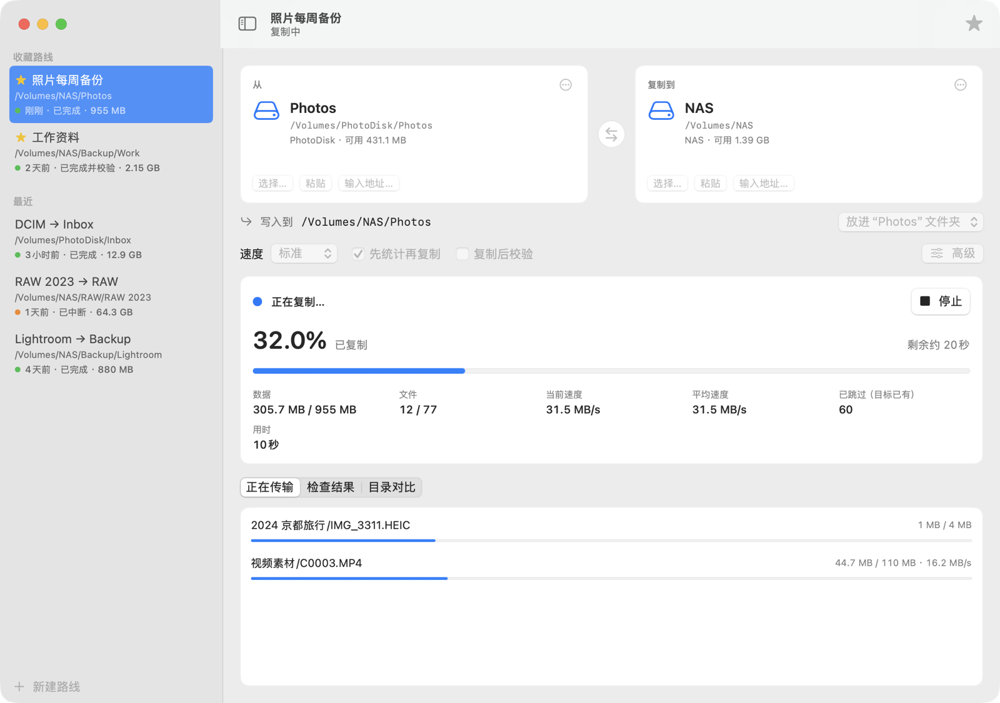

<div align="center">


# Disk Ferry

**Move big folders calmly: a native macOS copy tool for external drives, NAS and Windows shares**

[](https://github.com/kekincai/DiskFerry/actions/workflows/ci.yml)


[](LICENSE)

[简体中文](README.md) · English

<picture>
  <source media="(prefers-color-scheme: dark)" srcset="docs/screenshots/copying-dark.png">
  
</picture>

</div>

> The interface is currently in Simplified Chinese.

## Why

Copying hundreds of gigabytes of photos and video to an SMB share with Finder often means an unreliable progress bar, no clear way to resume after a disconnect, and thumbnails and Spotlight reading the disk in the background.

Disk Ferry hands the copy to [rclone](https://rclone.org/) and focuses on one thing: making "copy this folder from A to B" easy and trustworthy enough to do every day.

```text
external drive / local folder  ──rclone──▶  SMB share / NAS / another drive
```

## Highlights

- **Routes, not forms.** Every copy is saved as a route in the sidebar with its last result. Pin the ones you use often and re-sync with one click.
- **Set locations however is handy.** Drag a folder from Finder, paste a folder you copied with ⌘C, or type `smb://server/share/folder` or `\\server\share\folder`. Shares that are not mounted are connected with the standard macOS login sheet.
- **Always see where files land.** "Put into a folder of the same name" (like a Finder drag) or "merge into the destination", with the exact write path shown.
- **Accurate, cheap live progress.** Percent, bytes, files, current and average speed, ETA, skipped files and in-flight files come from rclone's own stats, refreshed once per second while only the progress area redraws.
- **Resume by running again.** Files already on the destination are skipped.
- **Nothing extra on disk.** No log files, summaries, thumbnails or caches. rclone's errors are shown in the window only when a run fails. On exFAT and FAT disks, the 4 KB `._` files macOS attaches to every copied file are cleaned up after the copy.
- Keeps the Mac awake while copying, shows progress on the Dock icon, notifies when a background copy finishes, and asks before quitting mid-copy.
- Optional size-only verification after copying (`rclone check --size-only`).

## Install

Requires macOS 13+ (Apple silicon or Intel) and rclone:

```bash
brew install rclone
```

**Download:** get the latest `DiskFerry-x.y.z.dmg` from [Releases](https://github.com/kekincai/DiskFerry/releases/latest) and drag **Disk Ferry** to Applications. The builds are not notarized yet, so the first time, **right-click → Open** in Applications. If macOS says the app is damaged, run `xattr -dr com.apple.quarantine "/Applications/Disk Ferry.app"`.

**From source:**

```bash
git clone https://github.com/kekincai/DiskFerry.git
cd DiskFerry
./script/build_and_run.sh              # debug build and launch
./script/package_release.sh 0.0.0      # universal .dmg / .zip in dist/release/
```

## Usage

1. **Set the source** (从): drag the folder onto the left card, or use 选择… (Choose), 粘贴 (Paste) or 输入地址… (Enter address).
2. **Set the destination** (复制到) the same way. The **⋯** menu lists connected drives and shares, recent locations, and 连接服务器… (Connect to Server).
3. **Check where files land:** 写入到 (Write to) under the cards is the folder the files end up in.
4. **Start copying** (⌘R). If unsure, run a **dry run** (预演, ⇧⌘R) first: it only counts what would be copied, writes nothing and does not create the destination folder.
5. Finished routes appear in the sidebar. Click ☆ to pin one, then select it and click 再次同步 (Sync again) next time.

| Option | What it does |
| --- | --- |
| Speed (速度) | Conservative (1 parallel transfer) / Normal (2) / Fast (4) / Custom. Use Conservative for spinning disks and weak Wi‑Fi, Fast for gigabit Ethernet + SSD. |
| Count first (先统计再复制) | On by default. Compares everything before transferring, so totals and ETA are right from the start. |
| Verify after copying (复制后校验) | Checks every file's size again; does not read file contents. |
| Clean up macOS `._` files (清理 macOS 生成的 ._ 文件, in Advanced) | On by default. On disks that cannot store extended attributes natively (exFAT, FAT), macOS attaches a 4 KB `._` file to every file and folder written. After a successful copy, those that hold only `com.apple.provenance` are deleted; ones with Finder tags, resource forks or other data, and ones without a matching file, are kept. Dry runs and interrupted or failed runs do not clean up. Nothing happens on APFS and similar disks. |

## How live progress works

Each rclone process starts its remote-control server on `127.0.0.1` with a random password, and Disk Ferry polls `core/stats` once per second. The numbers are rclone's own accounting, not guesses from scanning folders.

The Advanced (高级) panel shows and copies the current route's command, without the per-run `--rc` flags:

```bash
RCLONE_RC_PASS=<random> rclone copy "$SOURCE" "$TARGET" \
  --check-first --local-no-clone \
  --transfers 1 --checkers 2 --retries 10 --low-level-retries 20 \
  --exclude ".DS_Store" --exclude "._*" --exclude ".Spotlight-V100/**" \
  --exclude ".Trashes/**" --exclude ".fseventsd/**" --exclude ".TemporaryItems/**" \
  --log-level NOTICE --use-json-log --stats 1h --stats-log-level NOTICE --stats-one-line \
  --rc --rc-addr 127.0.0.1:<random port> --rc-user diskferry
```

- `--check-first` compares everything before transferring, so totals and ETA are right from the start.
- `--local-no-clone` (added when the installed rclone supports it) makes rclone stream bytes itself instead of handing whole files to the OS, so large videos show smooth progress.
- `--modify-window 2s` is added only when the destination is an exFAT or FAT (`msdos`) disk. Their timestamps are only precise to 10 ms–2 s, so without it every re-run hashes both sides of every existing file and rewrites its time.
- `--exclude "._*"` only skips `._` files already in the source. The ones macOS creates on the destination are handled by the cleanup step after the copy (see the options table).
- `--log-level NOTICE --use-json-log --stats 1h …` keeps the console to errors plus one final stats line at exit, so runs that finish before the first poll still get exact numbers.
- The rc password reaches rclone through the `RCLONE_RC_PASS` environment variable, so other users on the Mac cannot read it with `ps`.

## Privacy and cache policy

Disk Ferry does not generate thumbnails, preview media, read EXIF, build a media database, hash every file by default, cache file contents, stage data locally, or write log files.

Local state is limited to settings and saved routes (`~/Library/Application Support/DiskFerry/recent_tasks.json`). rclone's output stays in memory and is shown only when a run fails.

## Scripting

```bash
open -b com.local.DiskFerry --args -source /Volumes/PhotoDisk/Photos -target /Volumes/NAS -autostart YES
```

## Development

```bash
swift build
swift test          # includes an end-to-end copy when rclone is installed
./script/build_and_run.sh --verify
```

```text
Sources/DiskFerry/App       entry point, menus, quit confirmation
Sources/DiskFerry/Models    route, progress and status models
Sources/DiskFerry/Services  rclone runner / stats, path parsing and mounting, precheck, safety policy
Sources/DiskFerry/Stores    app state, live progress, saved routes
Sources/DiskFerry/Support   formatting and small system helpers
Sources/DiskFerry/Views     SwiftUI interface
script/                     build, launch and icon scripts
```

Contributions are welcome — see [CONTRIBUTING.md](CONTRIBUTING.md). Disk Ferry should stay a low-cache copy controller, not a photo manager, file browser or indexer.

## License

MIT. See [LICENSE](LICENSE).
